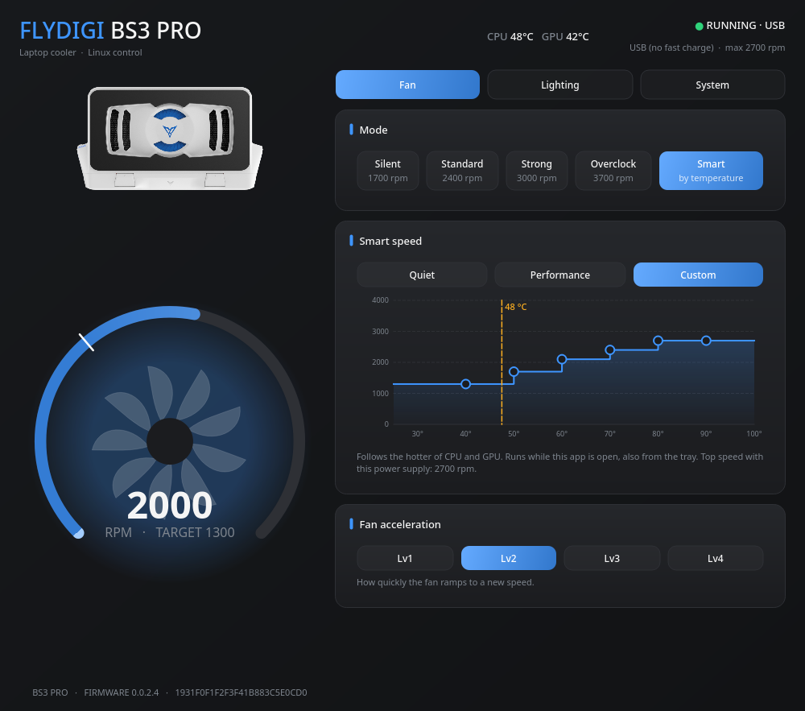
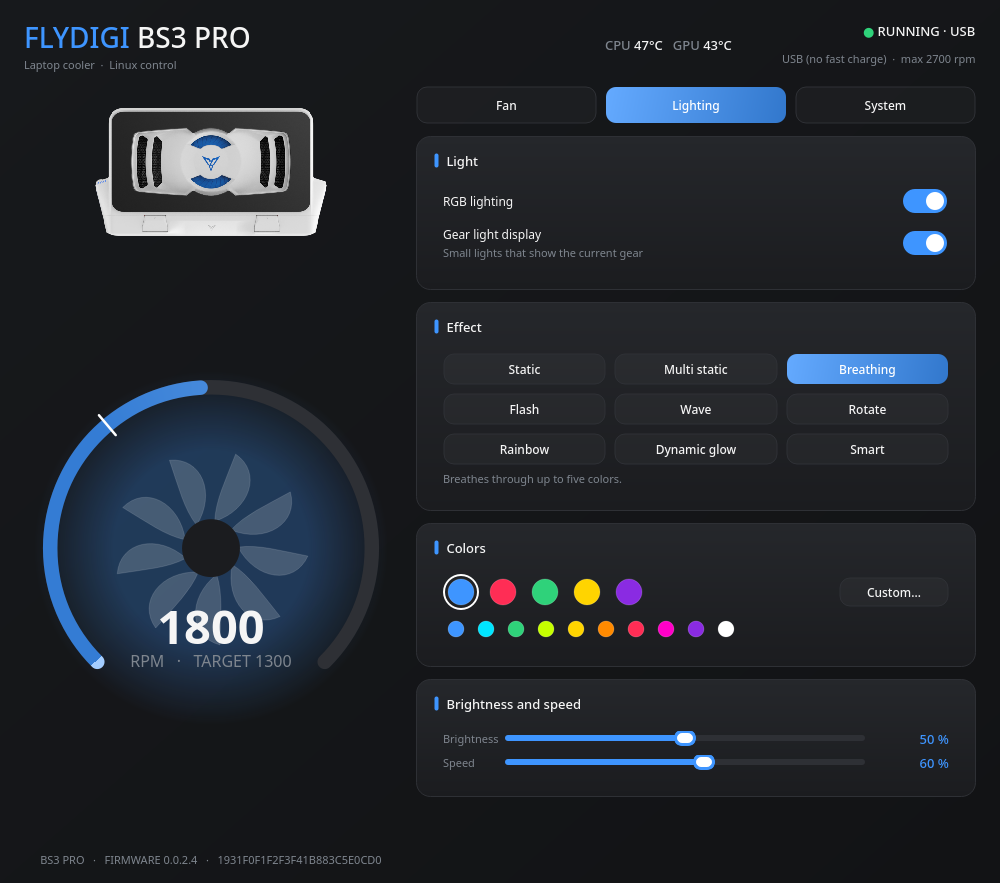
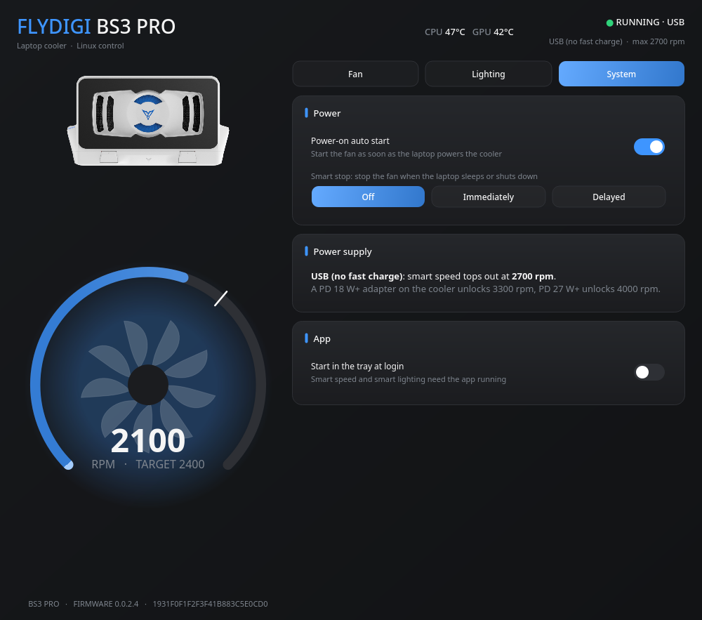

# BS Control

Linux control panel, tray icon and CLI for the **Flydigi BS3 Pro** laptop cooler (and the
BS2 / BS2 Pro / BS3, which use the same protocol). It replaces Flydigi Space Station on Linux.



The protocol was reverse engineered from Flydigi Space Station 36.9.5 (`SpaceStationService.exe`,
`Flydigi.CoolerSdk`) and checked on a BS3 Pro (`37d7:1004`, firmware 0.0.2.4) over USB.

Tested on CachyOS with KDE Plasma 6 (Wayland).

| Lighting | System |
|---|---|
|  |  |

## Features

- Live fan speed and target, CPU / GPU temperature, power supply and its speed cap
- The four fan gears (Silent / Standard / Strong / Overclock) and the speed stored for each gear
- Smart speed: follows the hotter of CPU and GPU with Space Station's Quiet and Performance
  curves, or your own curve (drag the points). Same step curve with 2 °C hysteresis as the
  Windows app, updated once a second
- Fan acceleration level
- Lighting: Static, Multi static, Breathing, Flash, Wave, Rotate, Rainbow, Dynamic glow and Smart
  (color follows temperature), up to six colors, brightness and speed; gear indicator lights
- Power-on auto start and smart stop
- Tray icon with quick gear switching; starts in the tray at login

Smart speed runs on the PC, like on Windows: the cooler only holds the speed it was last given.
Keep the app running in the tray for it. Quitting the app hands the fan back to the cooler's
current gear.

GPU temperature comes from the laptop's EC sensor when the platform driver exposes one (for
example `uniwill-laptop`), from `amdgpu`, or from `nvidia-smi` only while the NVIDIA card is
already awake, so smart speed never wakes a sleeping dGPU.

## Install

Needs Python 3.10+ and PySide6 6.x. On Arch / CachyOS:

```bash
git clone https://github.com/OthrineTM/bs-control
cd bs-control
sudo pacman -S pyside6
sudo install -m644 70-flydigi-cooler.rules /etc/udev/rules.d/ && sudo udevadm control --reload && sudo udevadm trigger --subsystem-match=hidraw
./install.sh
```

The product photo in the window belongs to Flydigi, so it isn't included. To show it, copy
Space Station's product image (`images/product/Cooler/bs3pro/main.png` inside
`resources/app.asar`, unpack with `npx @electron/asar extract`) to `assets/bs3pro.png` before
running `install.sh`. git ignores `assets/`. Without it the window shows the fan gauge only.

`install.sh` installs per user into `~/.local/share/bs-control` and adds a menu entry plus a
tray autostart. Remove everything with `./install.sh --uninstall`.

## CLI

```
bs-control                       # GUI
bs-control status
bs-control rpm
bs-control gear 3                # or silent / standard / strong / overclock
bs-control gear 2 --rpm 2200     # store a new speed for a gear
bs-control speed 1800            # hold a fixed speed (until the next 'gear')
bs-control accel 2
bs-control light breathing --color 3e95ff --color ff2d55 --brightness 80 --speed 60
bs-control light smart | off | on
bs-control gear-light off
bs-control auto-start on
bs-control smart-stop delayed
```

## Protocol

32-byte HID reports without a report ID on the cooler's only interface. Requests:

```
5A A5 <cmd> <len> <payload...> <sum>
```

`len` = 2 + payload length, `sum` = 8-bit sum of cmd, len and payload. The cooler answers with
`03 5A A5 <cmd> <len> <data...>`; setters return `01` on success. About twice a second it also
sends a status report (`EF`) on its own.

| Command | Request payload | Answer |
|---|---|---|
| `01` firmware | | 4 bytes |
| `04` MAC address | | 6 bytes |
| `09` device type | | 1 byte |
| `0B` UID | | 13 bytes |
| `08` switch gear | gear 1–4 | ack |
| `0C` power-on auto start | 1 on, 2 off | ack |
| `0D` smart stop | 0 off, 1 immediately, 2 delayed | ack |
| `21` set speed (smart mode) | rpm LE16 | ack |
| `22` fan speed | | current LE16, target LE16 |
| `23` / `24` enter / leave smart mode | | ack |
| `25` fan mode | | gear − 1 |
| `26` set gear speed and switch | gear − 1, rpm LE16 | ack |
| `27` gear speeds | | 4 × LE16 |
| `2A` acceleration | level 0–3 | ack |
| `41`, `47`×n, `43` lighting upload | begin, index + 10 data bytes, end | ack |
| `44` smart lighting | level 1–4 (0 = off) | ack |
| `45` lighting state | | on, smart |
| `46` RGB on/off | 1 / 0 | ack |
| `48` gear lights | 1 / 0 | ack |

Status report (`EF`), offsets from `5A`: `[4]` bit 0 off, bits 1–2 gear − 1, bit 3 Bluetooth,
bit 4 USB, bits 5–6 power supply (1 USB, 2 QC, 3 PD); `[5]` bit 0 smart mode, bit 1 auto start,
bits 2–3 smart stop; `[6]` bit 0 gear lights, bit 1 smart lighting, bit 2 RGB; `[7..8]` rpm,
`[9..10]` target rpm, `[11]` acceleration.

A lighting upload is a 6-byte header (`00 02`, loop start, loop end, 11 − frame time, brightness
0–100) and 6 LEDs × 10 frames × RGB, sent in 10-byte chunks.

Space Station caps smart speed by power supply: BS2 Pro / BS3 Pro 2700 rpm on plain USB,
3300 rpm with QC or PD 18 W+, 4000 rpm with PD 27 W+.

Bluetooth (BLE HID) works too: there the reports use ID 1 (in) and 2 (out) with 24 bytes, which the
app reads from the report descriptor. Untested: firmware updates
(still need Space Station on Windows) and the BS2 / BS3 non-Pro models.

## License

GPL-3.0. Unofficial project, not affiliated with or endorsed by Flydigi. Flydigi and BS3 Pro are
trademarks of their owner.
